# SENTRIA — Intelligent Astronaut Health Monitoring System

  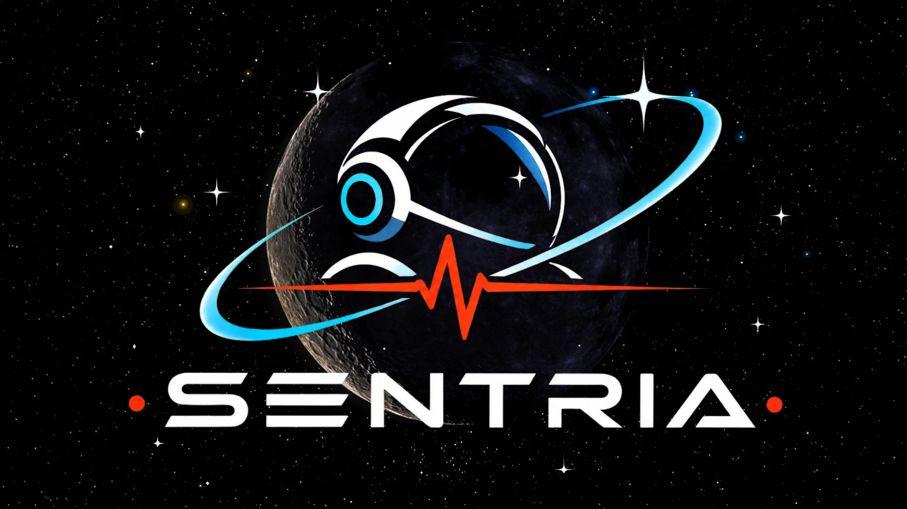

**Team: [SENTRIA](https://www.spaceappschallenge.org/2026/find-a-team/iaso/?tab=details)**

An intelligent health monitoring system designed to support astronaut well-being during space missions through the integration of physiological and environmental data. SENTRIA combines an ESP32-based hardware platform, multiple sensors, and a centralized monitoring interface to collect, process, and visualize relevant health indicators.

The system integrates real-time monitoring capabilities, individual baseline comparisons, and an alert mechanism to help identify potential physiological and environmental anomalies. Through a Nextion touchscreen display and a web-based dashboard, SENTRIA provides an accessible visualization of collected information, supporting continuous health monitoring and data-driven decision-making in space environments.

## Map of Contents

1. [About the Project](#about-the-project)
2. [Introduction](#introduction)
3. [Video Demonstration](#video-demonstration)
4. [SENTRIA Monitoring Dashboard](#sentria-monitoring-dashboard)
5. [Hardware Prototype](#hardware-prototype)
6. [Physiological Monitoring](#physiological-monitoring)
7. [Environmental Monitoring](#environmental-monitoring)
8. [Data Acquisition and Processing](#data-acquisition-and-processing)
9. [Individual Baseline and Alert System](#individual-baseline-and-alert-system)
10. [Data Visualization and Analysis](#data-visualization-and-analysis)
11. [Communication System: MQTT](#communication-system-mqtt)
12. [System Architecture](#system-architecture)
13. [NASA Challenge Requirements and Implementation](#nasa-challenge-requirements-and-implementation)
14. [Installation and Setup](#installation-and-setup)
15. [Results and Validation](#results-and-validation)
16. [Limitations and Future Development](#limitations-and-future-development)
17. [File Descriptions](#file-descriptions)
18. [Scientific Background and References](#scientific-background-and-references)
19. [Technologies Used](#technologies-used)
20. [Team Members and Contributions](#team-members-and-contributions)

## About the Project

Submission for the NASA International Space Apps Challenge. https://www.spaceappschallenge.org/2026/challenges/health-monitoring-software/

Space exploration exposes astronauts to demanding conditions that can affect their physical health and overall well-being. During space missions, changes in gravity, radiation exposure, isolation, sleep disruption, and other environmental factors can influence physiological processes and create challenges for continuous health monitoring.

  

SENTRIA is an intelligent astronaut health monitoring system designed to integrate physiological and environmental information into a centralized platform. The project aims to provide a comprehensive view of astronaut health by combining sensor-based data acquisition, embedded systems, data processing, and interactive visualization.

The system uses an ESP32-S3 as its central hardware platform, connecting different sensors to collect information such as heart rate, heart rate variability (HRV), skin temperature, cabin temperature, humidity, light levels, and movement. These measurements are processed and organized to provide relevant information about the astronaut's physiological condition and surrounding environment.

To make the collected information accessible, SENTRIA incorporates two visualization interfaces: a Nextion touchscreen display for local monitoring and a web-based dashboard for viewing measurements, alerts, and individual baseline comparisons. The platform also incorporates MQTT communication to enable data transmission between the hardware and external monitoring interfaces.

  

An important component of SENTRIA is its individual baseline approach. Rather than relying exclusively on generalized reference values, the system considers the astronaut's baseline measurements to identify deviations from their typical physiological patterns. This approach supports the identification of potential anomalies and provides additional context for interpreting collected data.

Our objective is to develop an integrated monitoring solution that supports astronaut health assessment during space missions by bringing together physiological measurements, environmental monitoring, data analysis, and alert mechanisms within a single system.

SENTRIA is conceived as a modular and expandable platform, allowing additional sensors, analytical capabilities, and predictive models to be incorporated as the project evolves.

## Introduction

Astronauts face unique health challenges during space missions. Microgravity, radiation exposure, changes in sleep patterns, and prolonged isolation can affect the human body in different ways. Monitoring these conditions is essential to understanding how astronauts respond to the space environment and identifying changes that may require attention.

SENTRIA was developed as a response to the need for an integrated system capable of collecting and organizing different types of health-related information. Instead of relying on separate monitoring devices, our approach brings physiological and environmental measurements together in a single platform.

The system combines an ESP32-S3 microcontroller, multiple sensors, a local touchscreen interface, and a web-based dashboard. This architecture allows information to be collected, processed, displayed, and transmitted through a unified monitoring system.

One of the main features of SENTRIA is the use of individual baselines. Since physiological measurements can vary between individuals, the system allows collected information to be compared against personalized reference values. This provides additional context when identifying deviations from an astronaut's typical measurements.

  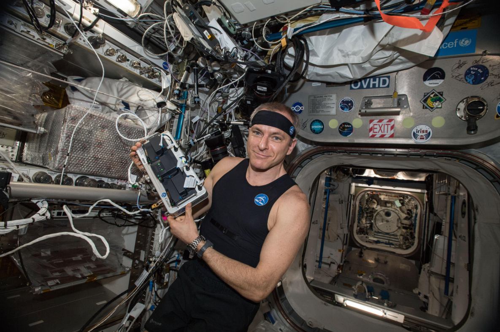

Our goal is to create an accessible and expandable prototype that demonstrates how embedded systems and connected technologies can contribute to astronaut health monitoring.

## Video Demonstration

The following video presents SENTRIA's prototype, its main components, and the operation of its monitoring platform.

  

<em>Click the image to watch the SENTRIA demonstration.</em>

Above: SENTRIA system demonstration.

## SENTRIA Monitoring Dashboard

The SENTRIA web dashboard serves as the main interface for visualizing and organizing the information collected by the monitoring system.

It provides an overview of the astronaut's physiological and environmental measurements, allowing users to observe current readings, review alerts, and compare measurements against individual baseline values.

The dashboard separates real-time sensor measurements from manually entered information. This distinction helps users identify which values are being collected directly by the hardware and which are provided through external records or laboratory measurements.

  

Above: Main interface of the SENTRIA monitoring dashboard.

The dashboard incorporates the following features:

- Real-Time Monitoring: Displays measurements received from the ESP32-S3, including heart rate, HRV, temperature, humidity, light, and movement information.

- Individual Baselines: Allows measurements to be compared against personalized reference values.

- Alert Visualization: Highlights measurements that exceed configured thresholds or deviate from established baselines.

- Manual Data Entry: Supports the registration of additional health information that is not directly measured by the current sensor kit.

- Historical Records: Organizes collected measurements to support the review of monitoring sessions.

- Data Export: Allows recorded information to be downloaded in CSV format for further analysis.

The dashboard is designed to provide a centralized view of the available information, making it easier to interpret measurements and identify relevant changes over time.

## Hardware Prototype

The hardware prototype is the physical foundation of SENTRIA. It integrates the ESP32-S3 microcontroller with different sensors and peripheral devices to collect physiological and environmental information.

The ESP32-S3 acts as the central processing unit, receiving sensor measurements and coordinating communication with the monitoring interfaces. The system also includes a Nextion touchscreen display, which provides local access to important measurements, system information, and alerts.

  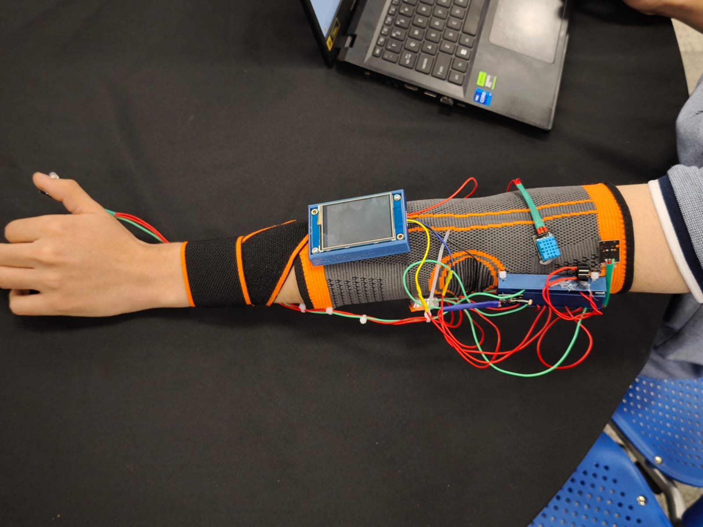

Above: SENTRIA hardware prototype and its main electronic components.

### Main Components

The prototype integrates the following components:
ESP32-S3: Central unit for sensor acquisition, processing, and communication 

  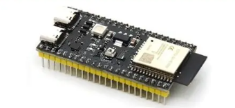

KY-039 Pulse Sensor: Measures pulse information used to estimate heart rate and HRV

  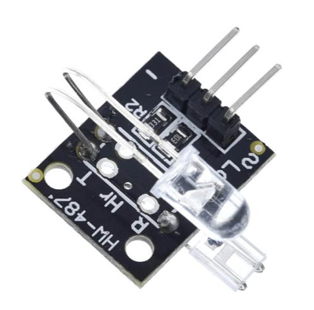

KY-013 Temperature Sensor: Measures temperature through an NTC thermistor

  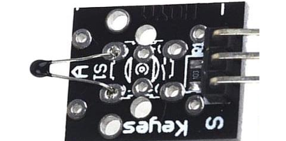

DHT11 (KY-015): Measures environmental temperature and humidity

  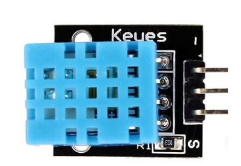

KY-018 Photoresistor: Detects ambient light levels

  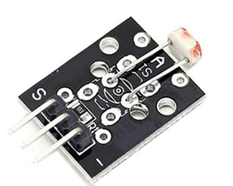

KY-012 Active Buzzer: Produces audible alerts

  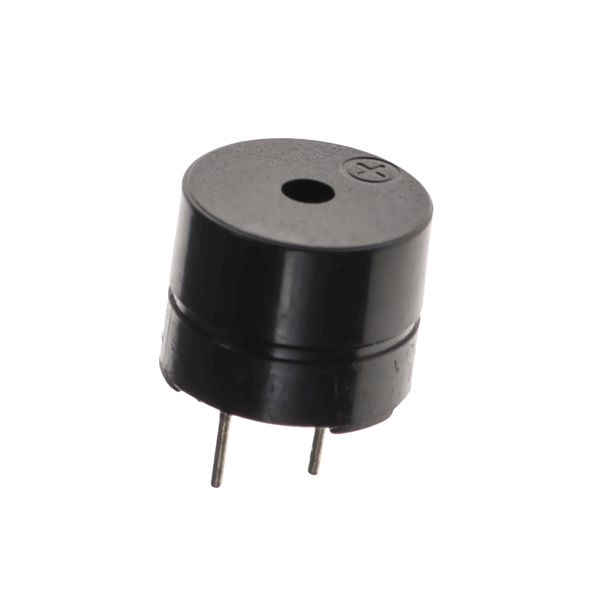

Nextion NX3224T024: Provides a local touchscreen monitoring interface

  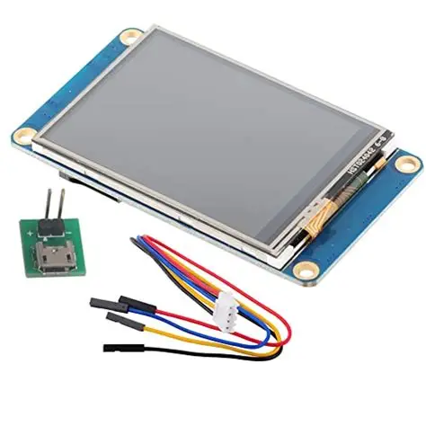

External Geiger Counter(FUTURE implement): Provides radiation pulse measurements

### Sensor Integration

The sensors are connected to the ESP32-S3 through its GPIO and analog input pins. Each component contributes information to a different monitoring function.

  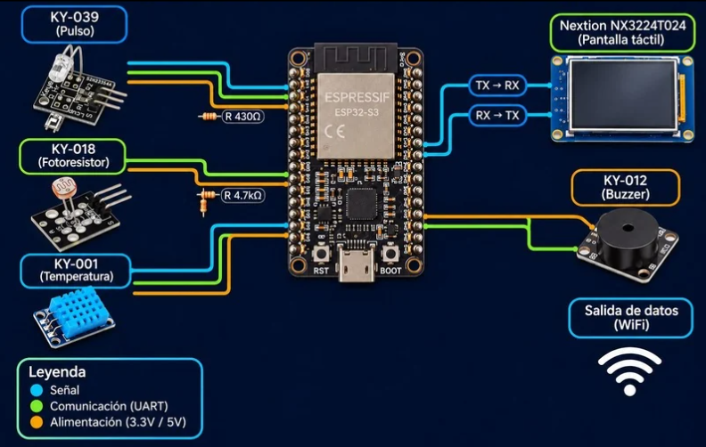

Above: Sensor integration with the ESP32-S3.

The prototype organizes its measurements into two main groups:

- Physiological Monitoring: Heart rate, heart rate variability, and body temperature.
- Environmental and Activity Monitoring: Cabin temperature, humidity, light levels, movement, and radiation measurements.

The Nextion display provides three main sections:

- Vitals: Displays heart rate, HRV, body temperature, and alerts.
- Environment: Displays radiation, cabin conditions, activity, and light information.
- System: Displays system status, uptime, connection information, and configuration options.

**VIDEO PROTOTYPE TRIAL**

  

  <em>Click the image to watch the SENTRIA demonstration.</em>

The prototype is designed to operate as an integrated monitoring unit, combining sensor acquisition, local visualization, and wireless communication. Its modular architecture also allows additional sensors and monitoring capabilities to be incorporated in future development.

### Nextion Touchscreen Interface

The Nextion NX3224T024 touchscreen provides a local interface for accessing essential system information without requiring the web dashboard.
The interface is organized into three main sections:

- Vitals: Displays heart rate, HRV, body temperature, and alerts.
- Environment: Displays radiation, cabin conditions, activity, and light information.
- System: Displays system status, uptime, connection information, and configuration options.

  

Above: Local monitoring interface displayed on the Nextion touchscreen.

The prototype is designed to operate as an integrated monitoring unit, combining sensor acquisition, local visualization, and wireless communication. Its modular architecture also allows additional sensors and monitoring capabilities to be incorporated in future development.

## Physiological Monitoring

SENTRIA incorporates sensors and data-entry capabilities to collect and organize information related to an astronaut's physiological condition.

The current prototype focuses on three main physiological measurements:

- Heart Rate: The KY-039 pulse sensor detects pulse signals that are processed to estimate beats per minute (BPM).

- Heart Rate Variability (HRV): The system calculates an HRV indicator using the intervals between detected heartbeats.

- Body Temperature: The KY-013 thermistor provides temperature measurements through an analog input of the ESP32-S3.

  

Above: Physiological measurements integrated into SENTRIA.

Additional health information, such as oxygen saturation (SpO₂) and blood pressure, can be entered manually through the dashboard. These values are not automatically measured by the current sensor kit.

By organizing these measurements in one platform, SENTRIA provides a foundation for monitoring physiological information and comparing it against individual reference values.

## Environmental Monitoring

In addition to physiological measurements, SENTRIA incorporates sensors to monitor environmental conditions and activity-related information.

These measurements provide additional context for understanding the conditions surrounding the astronaut. The current prototype includes:

- Cabin Temperature and Humidity: The DHT11 sensor measures environmental temperature and relative humidity.

- Light Levels: The KY-018 photoresistor detects changes in ambient light, providing contextual information that can help interpret sleep and activity patterns.

- Movement Detection: The KY-002 vibration sensor detects movement or activity changes.

- Radiation Measurements: An external Geiger counter can provide pulse information that the ESP32-S3 uses to calculate counts per minute (CPM).

  

Above: Environmental and activity monitoring components.

These measurements complement physiological information by providing a broader overview of the astronaut's monitoring environment.

## Data Acquisition and Processing

The ESP32-S3 acts as the central unit responsible for acquiring information from the connected sensors and organizing the collected measurements.

Each sensor provides information through its corresponding input. The microcontroller processes these signals and prepares the resulting measurements for visualization and communication.

The system follows a continuous data acquisition process:

- Sensor Acquisition: Sensors collect physiological and environmental information.

- Signal Processing: The ESP32-S3 processes the incoming signals and calculates the corresponding measurements.

- Data Organization: Measurements are organized into structured telemetry information.

- Communication: Data is transmitted through MQTT when an external network connection is configured.

- Visualization: The monitoring interfaces display the available information and system alerts.

  

Above: General data acquisition and processing workflow.

SENTRIA also supports local operation. The ESP32-S3 can create its own Wi-Fi access point, allowing a nearby device to connect to the monitoring dashboard without requiring an external internet connection.

This functionality provides an alternative way to access the system when an external network is unavailable.

## Individual Baseline and Alert System

One of SENTRIA's main features is its individual baseline approach. Physiological measurements can differ considerably between individuals, meaning that a single generalized reference value may not always provide enough context to interpret changes in an astronaut's condition.

To address this, SENTRIA allows users to register individual baseline values and compare them against current measurements.

The dashboard displays the current value, its corresponding baseline, and the percentage difference between them. Configurable tolerances help identify measurements that deviate from the established reference values.

  

Above: Individual baseline comparison and alert visualization.

The alert system incorporates two main approaches:

- Threshold-Based Alerts: Identifies measurements that exceed configured limits.

- Baseline Deviation Alerts: Identifies significant changes compared with an individual's established reference values.

The system also includes an audible alert through the KY-012 buzzer and visual notifications through the monitoring interfaces.

Manual health information can also be compared against registered baseline values, allowing the dashboard to organize additional information alongside real-time sensor measurements.

These mechanisms are intended to highlight relevant changes and support monitoring. They do not constitute medical diagnoses or replace professional medical assessment.

## Data Visualization and Analysis

SENTRIA incorporates a web-based dashboard and a Python analysis station to organize, visualize, and review the information collected during monitoring sessions.

The dashboard provides access to current measurements, individual baseline comparisons, and alerts, while the Python analysis station offers additional tools for reviewing historical records.

  

Above: Data visualization and monitoring interfaces.

### Historical Data Visualization

The Python analysis station retrieves measurements from the ESP32-S3 and stores them in CSV files. This allows monitoring sessions to be preserved and reviewed later.

The station includes graphical representations of individual measurements, with reference ranges to provide context when interpreting the collected data.

Users can review information across different time periods: 15 minutes, 1 hour, 6 hours or Complete monitoring session

  

Above: Historical measurements displayed through the Python analysis station.

### Statistical Analysis

In addition to visualizing measurements, the Python station calculates descriptive statistics to summarize monitoring sessions.

The available analysis includes:

- Mean, minimum, and maximum values.

- Standard deviation.
  
- Hourly measurement trends.

- Percentage of time within configured reference ranges.

- Alert episodes organized by type.

- Rest and activity information.

- Connection interruptions.

- Automatically generated textual findings based on the collected data.

The analysis can be performed over different time periods, allowing users to review both short-term changes and longer monitoring sessions.

### Data Export

SENTRIA supports CSV export to preserve collected measurements and facilitate further analysis using external tools.

  

Above: Exporting monitoring data for further analysis.

The current Python station focuses on descriptive statistics and configured alert rules. Predictive models and automated integration with external NASA datasets are considered future development opportunities.

## MQTT Communication

SENTRIA uses the MQTT protocol to transmit monitoring information between the ESP32-S3 and external applications. This communication method allows the system to publish telemetry data through a message broker, making the information accessible to connected monitoring interfaces.

The prototype uses a public Mosquitto test broker to demonstrate wireless data transmission. When an external Wi-Fi network is configured, the ESP32-S3 can publish measurements through the internet while maintaining its local access point.

The system organizes information into different MQTT topics:

| MQTT Topic | Description |
|---|---|
| `iaso/<ASTRO_ID>/telemetry` | Publishes real-time sensor measurements in JSON format. |
| `iaso/<ASTRO_ID>/status` | Reports whether the device is online or offline. |
| `iaso/<ASTRO_ID>/lab` | Stores manually entered health and laboratory information. |
| `iaso/<ASTRO_ID>/basal` | Stores individual baseline values. |

  

Above: MQTT communication between SENTRIA's hardware and monitoring platform.

Telemetry information is published periodically, while laboratory and baseline information can be retained by the broker to make the latest registered values available to connected clients.

The MQTT architecture allows SENTRIA to separate data acquisition from data visualization, providing flexibility for future integrations with additional monitoring applications.

For testing purposes, the published messages can be inspected using an MQTT client such as Mosquitto Sub. For example:

mosquitto_sub -h test.mosquitto.org -t "iaso/<ASTRO_ID>/#" -v

The current implementation uses a public test broker without authentication or encrypted communication. Therefore, it is intended for demonstration purposes and should not be used to transmit sensitive personal or medical information.

## System Architecture

SENTRIA follows a modular architecture that connects sensor acquisition, data processing, communication, and visualization.

The ESP32-S3 acts as the central hardware unit, collecting information from the connected sensors and preparing measurements for local display and external transmission.

The system can operate through two complementary communication paths:

- Local Monitoring: The ESP32-S3 creates a Wi-Fi access point that allows nearby devices to access the web dashboard without an external internet connection.

- MQTT Communication: When an external Wi-Fi network is configured, the system can publish telemetry and other information through an MQTT broker.

  

Above: General architecture of the SENTRIA monitoring system.

The architecture can be divided into the following stages:

| Stage | Main Element | Function |
|---|---|---|
| Data Acquisition | Sensors | Collect physiological and environmental information. |
| Processing | ESP32-S3 | Reads sensor signals, processes measurements, and organizes data. |
| Local Visualization | Nextion Display | Presents measurements, alerts, and system information. |
| Local Web Access | ESP32-S3 Wi-Fi Access Point | Provides access to the dashboard without external internet. |
| Data Visualization | Web Dashboard | Displays measurements, baselines, and alerts. |
| Historical Analysis | Python Analysis Station | Stores records and calculates descriptive statistics. |

This modular structure allows individual components to be modified or expanded without requiring a complete redesign of the system.

## NASA Challenge Requirements and Implementation

SENTRIA was developed in response to the NASA Space Apps Challenge: Health Monitoring Software.

The project focuses on integrating different types of astronaut health information into a centralized monitoring platform. The current prototype implements several monitoring and visualization functions while identifying additional capabilities for future development.

The following table summarizes the relationship between the project's main objectives and the current implementation:

| Monitoring Area | SENTRIA Implementation | Current Status |
|---|---|---|
| Cardiovascular Monitoring | Heart rate and HRV estimation using the KY-039 sensor. | Implemented |
| Body Temperature | Temperature measurement using the KY-013 thermistor. | Implemented |
| Environmental Monitoring | Cabin temperature and humidity measurement through the DHT11 sensor. | Implemented |
| Light Monitoring | Ambient light detection through the KY-018 sensor. | Implemented |
| Activity Monitoring | Movement detection using the KY-002 sensor. | Implemented |
| Radiation Monitoring | Pulse counting from an external Geiger counter. | Hardware integration supported |
| Sleep Context | Activity, rest duration, movement, and light information. | Basic implementation |
| Stress Monitoring | HRV deviation compared with individual baseline. | Basic implementation |
| Oxygen Saturation | Manual data entry through the dashboard. | Manual entry |
| Blood Pressure | Manual data entry through the dashboard. | Manual entry |
| Individual Baselines | Comparison between current and personalized reference values. | Implemented |
| Alert System | Configurable thresholds and baseline deviation alerts. | Implemented |
| Historical Data | CSV records and Python statistical analysis. | Implemented |
| Predictive Analysis | Advanced predictive models and automated NASA dataset integration. | Future development |

The current prototype demonstrates an integrated monitoring approach while recognizing that some health indicators require additional medical-grade sensors and validation before they can be measured automatically.

## Installation and Setup

### 1. Hardware Requirements
The following components are required to assemble the current prototype:
| Component | Quantity | Purpose |
|---|---:|---|
| ESP32-S3 Development Board | 1 | Main processing unit |
| KY-039 Pulse Sensor | 1 | Pulse signal acquisition |
| KY-013 Temperature Sensor | 1 | Body temperature measurement |
| KY-015 DHT11 Module | 1 | Environmental temperature and humidity measurement |
| KY-018 Photoresistor | 1 | Ambient light detection |
| KY-002 Vibration Sensor | 1 | Movement detection |
| External Geiger Counter | 1 | Radiation pulse acquisition |
| KY-012 Active Buzzer | 1 | Audible alerts |
| Nextion NX3224T024 | 1 | Touchscreen interface |
| Jumper Wires and Breadboard | As needed | Electrical connections |

### 2. Software Requirements
The following software and tools are used to develop, configure, and operate SENTRIA:

| Software or Tool | Purpose |
|---|---|
| Visual Studio Code | Firmware development, source code editing, and project management |
| PlatformIO / ESP32 Development Tools | ESP32-S3 firmware compilation and upload |
| Nextion Editor | Touchscreen interface development |
| Python 3 | Historical data analysis station |
| Web Browser | Access to the monitoring dashboard |

### 3. Firmware Configuration
Follow these steps to configure and upload the firmware:
1. Clone or download the SENTRIA repository.
2. Open the firmware project located in firmware/IASO/.
3. Open config.h and configure the Wi-Fi credentials, MQTT broker, device identifier, and sensor pins.
4. Select the appropriate ESP32-S3 board configuration in Arduino IDE.
5. Compile and upload the firmware to the ESP32-S3.
Board configuration: The firmware should be compiled using the ESP32S3 Dev Module board configuration.

### 4. Dashboard Configuration
1.Power on the ESP32-S3.
2.Connect to the Wi-Fi network:
- SSID: IASO-astro01
- Password: iaso1234
3.Open a browser and access:
- http://192.168.4.1
- 
### 5. Running the Analysis Station

Run the following command from the project directory:

  python dashboard/estacion.py

Then open http://localhost:8080 in your browser to access historical data analysis.

## Results and Validation

The current SENTRIA prototype demonstrates the integration of multiple sensors, local data acquisition, wireless communication, and monitoring interfaces within a single system.

The implemented features provide a foundation for collecting physiological and environmental information and presenting it through different visualization tools.

The main results include:

- Feature
- Result
- Sensor Integration
- Multiple sensors connected to the ESP32-S3.
- Local Monitoring
- Measurements displayed through the Nextion touchscreen.
- Web Dashboard
- Browser-based visualization of collected information.
- MQTT Communication
- Telemetry transmission through an MQTT broker.
- Individual Baselines
- Comparison between current measurements and personal reference values.
- Alerts
- Visual and audible notifications based on configured conditions.
- Historical Records
- Measurement storage in CSV format.
- Statistical Analysis
- Descriptive analysis through the Python station.

  

Above: SENTRIA prototype during system testing.

The prototype demonstrates how different monitoring components can be integrated into a centralized platform. Further testing with calibrated instruments, medical-grade sensors, and realistic operating conditions will be necessary to evaluate measurement accuracy and reliability.

## Limitations and Future Development

Although SENTRIA provides an integrated monitoring prototype, some capabilities remain limited by the sensors and technologies currently available.

Understanding these limitations is important for identifying the next steps in the development of the project.

### Current Limitations

| Area | Current Limitation |
|---|---|
| Heart Rate | The KY-039 is an educational sensor that requires further validation. |
| HRV | Calculated from heartbeat intervals and affected by signal quality. |
| SpO₂ | No automatic oxygen saturation sensor is currently integrated. |
| Blood Pressure | Measurements must be entered manually. |
| Radiation | Requires an external Geiger counter, not included in the sensor kit. |
| Movement | The KY-002 detects vibration but does not provide detailed motion data. |
| Stress | Uses HRV deviation as a basic indicator, not a clinical assessment. |
| Predictive Models | Advanced predictive algorithms are not yet implemented. |
| Data Security | MQTT security features are planned but not yet implemented. |

### Future Development

Future improvements could expand SENTRIA's monitoring capabilities and increase the reliability of the system.

| Proposed Improvement | Objective |
|---|---|
| MAX30102 Sensor | Enable automatic heart rate and SpO₂ measurement. |
| AD8232 ECG Module | Incorporate electrocardiogram signal acquisition. |
| GSR Sensor | Add skin conductance measurements as another physiological indicator. |
| MPU6050 Accelerometer and Gyroscope | Improve movement and activity monitoring. |
| Medical-Grade Sensors | Increase measurement accuracy and reliability. |
| Secure MQTT Broker | Implement authentication and encrypted communication. |
| Predictive Models | Identify patterns and potential health risks. |
| NASA Dataset Integration | Incorporate relevant external datasets for further analysis. |
| Expanded Data Analysis | Improve historical analysis and generate more comprehensive reports. |

These developments would help transform SENTRIA from an educational prototype into a more comprehensive astronaut health monitoring platform.

## File Descriptions

The repository is organized into different directories to separate firmware, dashboard resources, analysis tools, and touchscreen interface files.

| File or Directory | Description |
|---|---|
| `firmware/IASO/` | Main ESP32-S3 firmware project. |
| `firmware/IASO/config.h` | Configuration of Wi-Fi, MQTT, and hardware settings. |
| `firmware/IASO/dashboard_html.h` | Embedded dashboard HTML used by the firmware. |
| `firmware/IASO/nextion/` | Nextion Editor project and touchscreen resources. |
| `firmware/NextionBridge/` | Firmware and utilities for transferring files to the Nextion display. |
| `firmware/NextionBridge/upload_tft.py` | Python utility for uploading the Nextion TFT file. |
| `dashboard/index.html` | Main web monitoring dashboard. |
| `dashboard/gen_header.py` | Generates the dashboard header embedded in the firmware. |
| `dashboard/estacion.py` | Python station for collecting and analyzing monitoring data. |
| `dashboard/datos/` | Directory used to store historical CSV records. |
| `images/` | Images used in the project documentation. |

## Scientific Support of the Project

SENTRIA is based on the importance of monitoring physiological and environmental conditions during human space exploration.

The project considers different areas of astronaut health, including cardiovascular activity, sleep, stress-related indicators, radiation exposure, and environmental conditions.

The monitoring approach also recognizes the importance of individual variability. Comparing measurements against personalized reference values can provide additional context when reviewing changes in physiological information.

The following sources should be included to document the scientific background and technical foundations of the project:

NASA research and documentation concerning astronaut health and human spaceflight.

Scientific publications on cardiovascular adaptation to microgravity.

Research on sleep and circadian rhythms during space missions.

Research on heart rate variability and physiological monitoring.

Technical documentation for the sensors and microcontroller used in the prototype.

  

Above: Scientific areas considered in the development of SENTRIA.

Note: Add the exact scientific publications, NASA documents, and technical datasheets consulted by the team before submitting the final repository.

## Languages, Frameworks, Platforms, APIs, and Other Technologies Used

SENTRIA combines embedded programming, web technologies, wireless communication, and data analysis tools.

| Technology | Application |
|---|---|
| C++ | ESP32-S3 firmware development. |
| HTML | Structure of the web dashboard. |
| CSS | Dashboard visual presentation. |
| JavaScript | Dashboard functionality and data visualization. |
| Python | Historical data collection and statistical analysis. |
| Visual Studio Code | Firmware development and source code management. |
| ESP32 Arduino Core | Framework for ESP32-S3 development. |
| Nextion Editor | Development of the touchscreen interface. |
| CSV | Storage and export of historical measurements. |
| Wi-Fi | Local wireless communication between the ESP32-S3 and connected devices. |
| MQTT | Planned communication protocol for future remote telemetry. |
| Mosquitto | Potential MQTT broker for future testing and communication. |

## Team Members and Their Contributions

SENTRIA was developed through the collaboration of a multidisciplinary team interested in combining engineering, programming, and technology to address challenges related to astronaut health monitoring.

Each team member contributed to different aspects of the project, including hardware integration, software development, data visualization, and system implementation.

- Juan Pedro Carrillo
- Valeria Alday
- Carlos Pérez
- César Castillo

  

Above: SENTRIA development team.

Through this collaboration, the team developed an integrated prototype that combines sensor acquisition, embedded systems, wireless communication, and data visualization to support astronaut health monitoring.

# IASO — monitor de signos vitales de astronauta (prototipo)

ESP32 + pantalla Nextion NX3224T024 + sensores del kit KY-xxx → MQTT (Mosquitto público) → dashboard web.
Basado en `Hackathon.pdf` (módulos cardiovascular, sueño, estrés, radiación, alertas con perfil basal).

## Estructura
- `firmware/IASO/` — sketch Arduino (`config.h`: red propia, WiFi, broker, pines)
- `dashboard/index.html` — dashboard. Lo sirve el propio ESP32 y también funciona por MQTT (archivo local o GitHub Pages)
- `dashboard/gen_header.py` — copia `index.html` a `firmware/IASO/dashboard_html.h`. **Córrelo cada vez que cambies el dashboard** y vuelve a subir el sketch

## Ver el dashboard en el celular (sin internet)
1. El ESP32 crea su propia red WiFi: **`IASO-astro01`**, contraseña **`iaso1234`** (se cambian en `config.h`).
2. Conecta el celular a esa red. Si Android avisa "sin internet", elige **mantener la conexión**.
3. Abre **http://192.168.4.1** en el navegador (con `http`, no `https`).

La página se actualiza cada 2.5 s. Los resultados de laboratorio quedan guardados en la flash del ESP32 aunque se reinicie.
Si además pones tu WiFi con internet en `WIFI_SSID`, también publica por MQTT. La red propia sigue activa, pero al conectarse
cambia al canal de tu router, y el celular puede desconectarse un momento.

## Estación de análisis en la laptop (sin internet)
`dashboard/estacion.py` recibe los datos del ESP32, los guarda y los analiza. Solo usa la librería estándar de Python.
1. Conecta la laptop a la red **`IASO-astro01`**.
2. Corre `python dashboard/estacion.py` y abre **http://localhost:8080**.

- Lee `http://192.168.4.1/data` cada 2 s y guarda cada muestra en `dashboard/datos/iaso_<fecha>.csv`.
  Al reiniciarse, vuelve a cargar todo lo guardado.
- Gráficas por métrica con el rango normal sombreado, y periodos de 15 min, 1 h, 6 h o todo.
- **Estudio** del periodo: promedio, mínimo, máximo, desviación, tendencia por hora, % del tiempo en rango normal,
  episodios de alerta por tipo, % de descanso, estrés (HRV más de 40 % bajo su valor típico), cortes de conexión
  y hallazgos en texto. Se exporta en .csv.
- `--esp http://IP` si el ESP32 tiene otra dirección. `--test` corre la autoprueba del análisis.

## Cableado (ESP32-S3, sensores a 3V3, GND común)
| Sensor | Módulo | Pin ESP32-S3 | Uso |
|---|---|---|---|
| Pulso | KY-039 | GPIO1 | BPM + HRV (RMSSD) |
| Fotorresistor | KY-018 | GPIO4 | luz (ciclo sueño) |
| Temp. corporal | KY-013 (placa HW-498, termistor NTC) | GPIO5 (analógico) | temperatura de piel; si al calentarlo baja, pon `NTC_HIGH 1` |
| Temp/humedad | KY-015 (DHT11) | GPIO6 | cabina |
| Vibración | KY-002 | GPIO7 | movimiento → activo/rest |
| Radiación | contador Geiger externo | GPIO15 | CPM |
| Buzzer activo | KY-012 | GPIO21 | alarma |
| Nextion | NX3224T024 | TX→GPIO17, RX→GPIO18, +5V→5V, GND | UI local |

Compilar con la placa **ESP32S3 Dev Module** (`esp32:esp32:esp32s3`). Si la placa tiene dos USB, usa el marcado **COM/UART**.

## Pantalla Nextion (táctil)
Proyecto en `firmware/IASO/nextion/IASO.HMI` (Nextion Editor, NX3224T024, horizontal, fondo negro). Tiene 3 páginas,
y se navega con la barra de abajo:
- **Vitales**: pulso, HRV, temperatura corporal y alertas.
- **Ambiente**: radiación, cabina, actividad y luz.
- **Sistema**: tiempo encendido, IP, MQTT, botón **Silenciar** (manda `M` al ESP32 y apaga el buzzer hasta que
  terminen las alertas) y barra de **brillo**.

Los valores son `vscope global`, así que el ESP32 los escribe con `pageN.tX.txt` aunque esa página no esté visible.

**Cargar el `.tft` sin microSD**, usando el ESP32 como puente USB↔pantalla:
1. Sube `firmware/NextionBridge` compilado a 9600:
   `arduino-cli compile --upload -p COM3 --fqbn esp32:esp32:esp32s3 --build-property "compiler.cpp.extra_flags=-DBAUD=9600" firmware/NextionBridge`
2. Carga la pantalla: `python firmware/NextionBridge/upload_tft.py COM3 firmware/IASO/nextion/IASO.tft 9600`
3. Vuelve a subir `firmware/IASO`.

Si una carga se interrumpe, la pantalla se queda en "writing data…": desconéctale la corriente unos 10 s y repite.

## Módulos del Hackathon → implementación
| Módulo (PDF) | Qué hace este prototipo |
|---|---|
| Cardiovascular | BPM + HRV (KY-039), alerta por rango fijo y por desviación >25 % del basal propio |
| Sueño | `act` active/rest por vibración (KY-002), `rest_min` = duración del descanso actual, `move` = movimientos por muestra, `light` para contexto de ciclo |
| Estrés | alerta `ESTRES` si la HRV cae >40 % bajo su basal (sin GSR en el kit) |
| Radiación | conteo de pulsos Geiger en GPIO15 → CPM |
| Óseo / inmunológico / perfil basal | carga manual en el dashboard → `iaso/<ASTRO_ID>/lab` (retained) |
| SpO₂, presión arterial, GSR | sin sensor en el kit: también carga manual en el dashboard (mismo topic `lab`) |
| Registro temporal / .csv | el dashboard guarda el historial de la sesión y lo descarga en .csv para el análisis en Python |

Cada dato manual se compara contra el **basal individual**: el dashboard tiene dos columnas (Actual y Basal) y calcula Δ %.
Marca "Fuera de rango" si excede la tolerancia (SpO₂ 3 %, presión 10 %, resto 15 %; editable en `TOL` de `index.html`).
El ESP32 guarda ambos en su flash (`/lab` y `/basal`) y, si hay MQTT, los publica retained en `iaso/<ASTRO_ID>/lab` y `iaso/<ASTRO_ID>/basal`.

El dashboard separa dos secciones: **Tiempo real** (solo lo que miden los sensores) y **Carga manual** (todo lo que requiere laboratorio o equipo que el kit no tiene).

## MQTT
Topics: `iaso/<ASTRO_ID>/telemetry` (JSON cada 5 s), `iaso/<ASTRO_ID>/status` (LWT online/offline) y
`iaso/<ASTRO_ID>/lab` (datos manuales actuales: laboratorio, SpO₂, presión, retained) y
`iaso/<ASTRO_ID>/basal` (basal individual de esos mismos datos, retained).
Prueba rápida: `mosquitto_sub -h test.mosquitto.org -t "iaso/<ASTRO_ID>/#" -v`

## Lo que el kit NO cubre (del PDF del hackathon)
- **SpO₂, ECG, presión arterial, GSR/electrodérmica**: no hay sensor en el kit (el KY-039 da pulso, no SpO₂). Añadir MAX30102, AD8232, sensor GSR.
- **Radiación**: ningún KY detecta radiación ionizante (el Hall KY-003/024 es magnético). Hace falta un tubo Geiger; el firmware ya cuenta pulsos en GPIO15.
- **Acelerómetro**: el kit no trae uno; el KY-002 (vibración) solo detecta "hubo movimiento", no aceleración ni patrones finos. Añadir MPU6050 para sueño/actividad reales.
- **Modelos predictivos y recomendaciones** (datasets NASA): no están hechos. `estacion.py` hace estadística descriptiva
  y reglas por umbral, no predicción. Los datos de laboratorio se capturan en el dashboard del ESP32, pero la estación
  todavía no los analiza.
- La Nextion NX3224T024 es un TFT resistivo, no OLED.

## Límites
- El broker público no tiene autenticación ni privacidad: ASTRO_ID único y solo datos de prueba. Para algo serio usa un Mosquitto propio con usuario/TLS.
- KY-039/DHT11/KY-013 son sensores didácticos, no médicos: tendencia, no diagnóstico.
