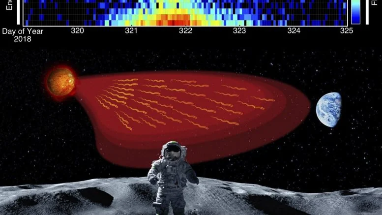

# SETRIA — Intelligent Astronaut Health Monitoring System

  

**Team: [SETRIA](https://www.spaceappschallenge.org/2026/find-a-team/iaso/?tab=details)**

An intelligent health monitoring system designed to support astronaut well-being during space missions through the integration of physiological and environmental data. SETRIA combines an ESP32-based hardware platform, multiple sensors, and a centralized monitoring interface to collect, process, and visualize relevant health indicators.

The system integrates real-time monitoring capabilities, individual baseline comparisons, and an alert mechanism to help identify potential physiological and environmental anomalies. Through a Nextion touchscreen display and a web-based dashboard, SETRIA provides an accessible visualization of collected information, supporting continuous health monitoring and data-driven decision-making in space environments.

## Map of Contents

1. [About the Project](#about-the-project)
2. [Introduction](#introduction)
3. [Video Demonstration](#video-demonstration)
4. [SETRIA Monitoring Dashboard](#setria-monitoring-dashboard)
5. [Hardware Prototype](#hardware-prototype)
6. [Physiological Monitoring](#physiological-monitoring)
7. [Environmental Monitoring](#environmental-monitoring)
8. [Data Acquisition and Processing](#data-acquisition-and-processing)
9. [Individual Baseline and Alert System](#individual-baseline-and-alert-system)
10. [Data Visualization and Analysis](#data-visualization-and-analysis)
11. [Communication System: MQTT](#communication-system-mqtt)
12. [System Architecture](#system-architecture)
13. [NASA Challenge Requirements and Implementation](#nasa-challenge-requirements-and-implementation)
14. [Installation and Setup](#installation-and-setup)
15. [Results and Validation](#results-and-validation)
16. [Limitations and Future Development](#limitations-and-future-development)
17. [File Descriptions](#file-descriptions)
18. [Scientific Background and References](#scientific-background-and-references)
19. [Technologies Used](#technologies-used)
20. [Team Members and Contributions](#team-members-and-contributions)

## About the Project

Submission for the NASA International Space Apps Challenge. https://www.spaceappschallenge.org/2026/challenges/health-monitoring-software/

Space exploration exposes astronauts to demanding conditions that can affect their physical health and overall well-being. During space missions, changes in gravity, radiation exposure, isolation, sleep disruption, and other environmental factors can influence physiological processes and create challenges for continuous health monitoring.

  

SETRIA is an intelligent astronaut health monitoring system designed to integrate physiological and environmental information into a centralized platform. The project aims to provide a comprehensive view of astronaut health by combining sensor-based data acquisition, embedded systems, data processing, and interactive visualization.

The system uses an ESP32-S3 as its central hardware platform, connecting different sensors to collect information such as heart rate, heart rate variability (HRV), skin temperature, cabin temperature, humidity, light levels, and movement. These measurements are processed and organized to provide relevant information about the astronaut's physiological condition and surrounding environment.

To make the collected information accessible, SETRIA incorporates two visualization interfaces: a Nextion touchscreen display for local monitoring and a web-based dashboard for viewing measurements, alerts, and individual baseline comparisons. The platform also incorporates MQTT communication to enable data transmission between the hardware and external monitoring interfaces.

An important component of SETRIA is its individual baseline approach. Rather than relying exclusively on generalized reference values, the system considers the astronaut's baseline measurements to identify deviations from their typical physiological patterns. This approach supports the identification of potential anomalies and provides additional context for interpreting collected data.

Our objective is to develop an integrated monitoring solution that supports astronaut health assessment during space missions by bringing together physiological measurements, environmental monitoring, data analysis, and alert mechanisms within a single system.

SETRIA is conceived as a modular and expandable platform, allowing additional sensors, analytical capabilities, and predictive models to be incorporated as the project evolves.

# IASO — monitor de signos vitales de astronauta (prototipo)

ESP32 + pantalla Nextion NX3224T024 + sensores del kit KY-xxx → MQTT (Mosquitto público) → dashboard web.
Basado en `Hackathon.pdf` (módulos cardiovascular, sueño, estrés, radiación, alertas con perfil basal).

## Estructura
- `firmware/IASO/` — sketch Arduino (`config.h`: red propia, WiFi, broker, pines)
- `dashboard/index.html` — dashboard. Lo sirve el propio ESP32 y también funciona por MQTT (archivo local o GitHub Pages)
- `dashboard/gen_header.py` — copia `index.html` a `firmware/IASO/dashboard_html.h`. **Córrelo cada vez que cambies el dashboard** y vuelve a subir el sketch

## Ver el dashboard en el celular (sin internet)
1. El ESP32 crea su propia red WiFi: **`IASO-astro01`**, contraseña **`iaso1234`** (se cambian en `config.h`).
2. Conecta el celular a esa red. Si Android avisa "sin internet", elige **mantener la conexión**.
3. Abre **http://192.168.4.1** en el navegador (con `http`, no `https`).

La página se actualiza cada 2.5 s. Los resultados de laboratorio quedan guardados en la flash del ESP32 aunque se reinicie.
Si además pones tu WiFi con internet en `WIFI_SSID`, también publica por MQTT. La red propia sigue activa, pero al conectarse
cambia al canal de tu router, y el celular puede desconectarse un momento.

## Estación de análisis en la laptop (sin internet)
`dashboard/estacion.py` recibe los datos del ESP32, los guarda y los analiza. Solo usa la librería estándar de Python.
1. Conecta la laptop a la red **`IASO-astro01`**.
2. Corre `python dashboard/estacion.py` y abre **http://localhost:8080**.

- Lee `http://192.168.4.1/data` cada 2 s y guarda cada muestra en `dashboard/datos/iaso_<fecha>.csv`.
  Al reiniciarse, vuelve a cargar todo lo guardado.
- Gráficas por métrica con el rango normal sombreado, y periodos de 15 min, 1 h, 6 h o todo.
- **Estudio** del periodo: promedio, mínimo, máximo, desviación, tendencia por hora, % del tiempo en rango normal,
  episodios de alerta por tipo, % de descanso, estrés (HRV más de 40 % bajo su valor típico), cortes de conexión
  y hallazgos en texto. Se exporta en .csv.
- `--esp http://IP` si el ESP32 tiene otra dirección. `--test` corre la autoprueba del análisis.

## Cableado (ESP32-S3, sensores a 3V3, GND común)
| Sensor | Módulo | Pin ESP32-S3 | Uso |
|---|---|---|---|
| Pulso | KY-039 | GPIO1 | BPM + HRV (RMSSD) |
| Fotorresistor | KY-018 | GPIO4 | luz (ciclo sueño) |
| Temp. corporal | KY-013 (placa HW-498, termistor NTC) | GPIO5 (analógico) | temperatura de piel; si al calentarlo baja, pon `NTC_HIGH 1` |
| Temp/humedad | KY-015 (DHT11) | GPIO6 | cabina |
| Vibración | KY-002 | GPIO7 | movimiento → activo/rest |
| Radiación | contador Geiger externo | GPIO15 | CPM |
| Buzzer activo | KY-012 | GPIO21 | alarma |
| Nextion | NX3224T024 | TX→GPIO17, RX→GPIO18, +5V→5V, GND | UI local |

Compilar con la placa **ESP32S3 Dev Module** (`esp32:esp32:esp32s3`). Si la placa tiene dos USB, usa el marcado **COM/UART**.

## Pantalla Nextion (táctil)
Proyecto en `firmware/IASO/nextion/IASO.HMI` (Nextion Editor, NX3224T024, horizontal, fondo negro). Tiene 3 páginas,
y se navega con la barra de abajo:
- **Vitales**: pulso, HRV, temperatura corporal y alertas.
- **Ambiente**: radiación, cabina, actividad y luz.
- **Sistema**: tiempo encendido, IP, MQTT, botón **Silenciar** (manda `M` al ESP32 y apaga el buzzer hasta que
  terminen las alertas) y barra de **brillo**.

Los valores son `vscope global`, así que el ESP32 los escribe con `pageN.tX.txt` aunque esa página no esté visible.

**Cargar el `.tft` sin microSD**, usando el ESP32 como puente USB↔pantalla:
1. Sube `firmware/NextionBridge` compilado a 9600:
   `arduino-cli compile --upload -p COM3 --fqbn esp32:esp32:esp32s3 --build-property "compiler.cpp.extra_flags=-DBAUD=9600" firmware/NextionBridge`
2. Carga la pantalla: `python firmware/NextionBridge/upload_tft.py COM3 firmware/IASO/nextion/IASO.tft 9600`
3. Vuelve a subir `firmware/IASO`.

Si una carga se interrumpe, la pantalla se queda en "writing data…": desconéctale la corriente unos 10 s y repite.

## Módulos del Hackathon → implementación
| Módulo (PDF) | Qué hace este prototipo |
|---|---|
| Cardiovascular | BPM + HRV (KY-039), alerta por rango fijo y por desviación >25 % del basal propio |
| Sueño | `act` active/rest por vibración (KY-002), `rest_min` = duración del descanso actual, `move` = movimientos por muestra, `light` para contexto de ciclo |
| Estrés | alerta `ESTRES` si la HRV cae >40 % bajo su basal (sin GSR en el kit) |
| Radiación | conteo de pulsos Geiger en GPIO15 → CPM |
| Óseo / inmunológico / perfil basal | carga manual en el dashboard → `iaso/<ASTRO_ID>/lab` (retained) |
| SpO₂, presión arterial, GSR | sin sensor en el kit: también carga manual en el dashboard (mismo topic `lab`) |
| Registro temporal / .csv | el dashboard guarda el historial de la sesión y lo descarga en .csv para el análisis en Python |

Cada dato manual se compara contra el **basal individual**: el dashboard tiene dos columnas (Actual y Basal) y calcula Δ %.
Marca "Fuera de rango" si excede la tolerancia (SpO₂ 3 %, presión 10 %, resto 15 %; editable en `TOL` de `index.html`).
El ESP32 guarda ambos en su flash (`/lab` y `/basal`) y, si hay MQTT, los publica retained en `iaso/<ASTRO_ID>/lab` y `iaso/<ASTRO_ID>/basal`.

El dashboard separa dos secciones: **Tiempo real** (solo lo que miden los sensores) y **Carga manual** (todo lo que requiere laboratorio o equipo que el kit no tiene).

## MQTT
Topics: `iaso/<ASTRO_ID>/telemetry` (JSON cada 5 s), `iaso/<ASTRO_ID>/status` (LWT online/offline) y
`iaso/<ASTRO_ID>/lab` (datos manuales actuales: laboratorio, SpO₂, presión, retained) y
`iaso/<ASTRO_ID>/basal` (basal individual de esos mismos datos, retained).
Prueba rápida: `mosquitto_sub -h test.mosquitto.org -t "iaso/<ASTRO_ID>/#" -v`

## Lo que el kit NO cubre (del PDF del hackathon)
- **SpO₂, ECG, presión arterial, GSR/electrodérmica**: no hay sensor en el kit (el KY-039 da pulso, no SpO₂). Añadir MAX30102, AD8232, sensor GSR.
- **Radiación**: ningún KY detecta radiación ionizante (el Hall KY-003/024 es magnético). Hace falta un tubo Geiger; el firmware ya cuenta pulsos en GPIO15.
- **Acelerómetro**: el kit no trae uno; el KY-002 (vibración) solo detecta "hubo movimiento", no aceleración ni patrones finos. Añadir MPU6050 para sueño/actividad reales.
- **Modelos predictivos y recomendaciones** (datasets NASA): no están hechos. `estacion.py` hace estadística descriptiva
  y reglas por umbral, no predicción. Los datos de laboratorio se capturan en el dashboard del ESP32, pero la estación
  todavía no los analiza.
- La Nextion NX3224T024 es un TFT resistivo, no OLED.

## Límites
- El broker público no tiene autenticación ni privacidad: ASTRO_ID único y solo datos de prueba. Para algo serio usa un Mosquitto propio con usuario/TLS.
- KY-039/DHT11/KY-013 son sensores didácticos, no médicos: tendencia, no diagnóstico.
